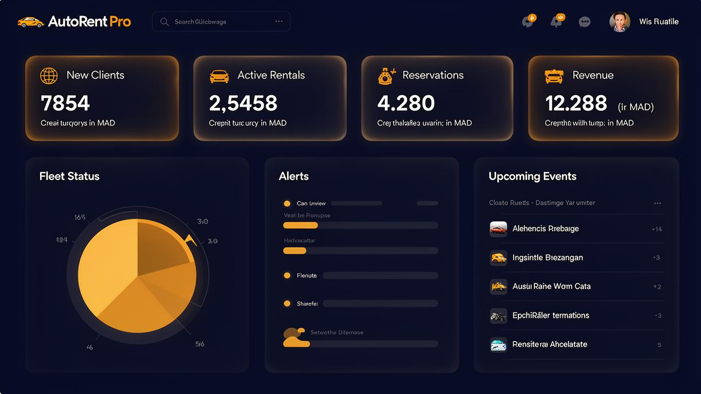
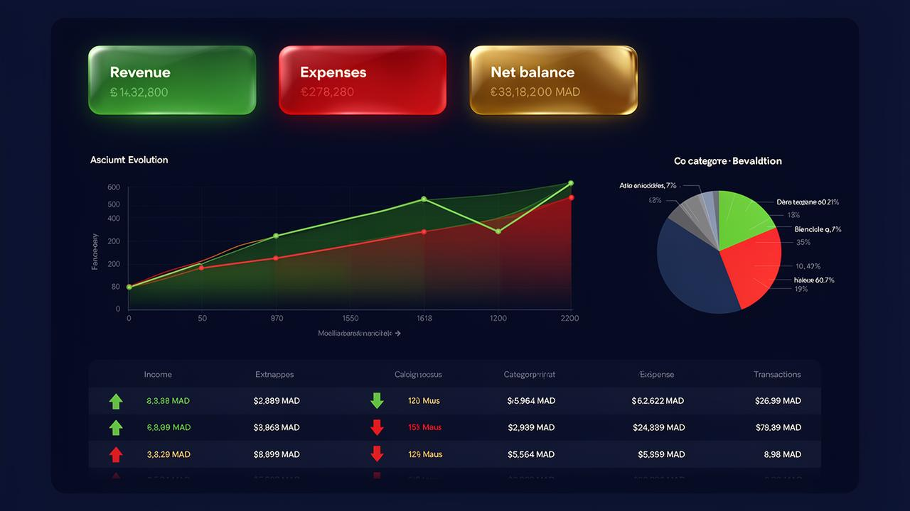

# 🚗 AutoRent Pro — Logiciel de Gestion de Location de Véhicules

<p align="center">
  
</p>

---

## ✨ Présentation

**AutoRent Pro** est une solution complète et moderne de gestion de location de véhicules, conçue pour les agences de location. Multi-agences, multi-utilisateurs, avec comptabilité intégrée et système de licence.

---

## 🎯 Fonctionnalités principales

| Module | Description |
|--------|-------------|
| 🏢 **Multi-Agences** | Gestion centralisée de plusieurs agences |
| 🚗 **Flotte** | Suivi des véhicules, statuts, documents (assurance, visite technique, carte grise) |
| 👥 **Clients** | Base de données clients avec système de liste noire |
| 📅 **Réservations** | Gestion des réservations avec conversion en locations |
| 📋 **Locations** | Contrats de location avec suivi des paiements |
| 💰 **Comptabilité** | Revenus, dépenses, graphiques, catégories |
| 👨‍✈️ **Chauffeurs** | Gestion des chauffeurs et suivi des permis |
| 👨‍💼 **Employés** | Gestion du personnel par agence |
| 🔐 **Authentification** | Système de rôles (Super Admin, Admin, Agent) |
| 🌙 **Thème sombre** | Mode clair / sombre intégré |
| 📱 **Responsive** | Interface adaptée mobile, tablette et desktop |
| 🔑 **Licence** | Système d'activation par domaine avec vérification serveur |

---

## 🛠️ Stack Technique

| Technologie | Usage |
|-------------|-------|
| **React 18** | Framework frontend |
| **TypeScript** | Typage statique |
| **Tailwind CSS** | Styling utilitaire |
| **shadcn/ui** | Composants UI |
| **Supabase** | Backend (PostgreSQL, Auth, Edge Functions) |
| **TanStack Query** | Gestion des données & cache |
| **Recharts** | Graphiques et visualisations |
| **React Router** | Navigation SPA |
| **Vite** | Build tool ultra-rapide |

---

## 📁 Structure du package

```
AutoRent-Pro-v1.0/
├── 📁 app/                  # Code source complet
│   ├── src/                 # Sources React/TypeScript
│   ├── public/              # Assets statiques
│   ├── supabase/            # Edge Functions
│   └── package.json
├── 📁 docs/                 # Documentation
│   ├── INSTALLATION.md
│   ├── CONFIGURATION.md
│   ├── ACTIVATION.md
│   ├── DEPLOYMENT.md
│   └── FAQ.md
├── 📁 database/             # Schéma SQL
│   └── schema.sql
├── 📁 assets/               # Captures d'écran
├── 📄 README.md             # Ce fichier
├── 📄 LICENSE.txt           # Licence commerciale
├── 📄 CHANGELOG.md          # Historique des versions
└── 📄 SUPPORT.txt           # Contact support
```

---

## ⚡ Démarrage rapide

```bash
cd app/
npm install
cp .env.example .env
# Configurez vos clés Supabase dans .env
npm run dev
```

📖 Guide complet : [`docs/INSTALLATION.md`](docs/INSTALLATION.md)

---

## 📸 Captures d'écran

| Dashboard | Véhicules | Comptabilité |
|-----------|-----------|--------------|
|  |  |  |

---

## 📄 Licence

Ce produit est distribué sous licence commerciale. Voir [`LICENSE.txt`](LICENSE.txt) pour les détails.

**Une licence = un domaine.**

---

## 💬 Support

📧 Consultez [`SUPPORT.txt`](SUPPORT.txt) pour nous contacter.

---

<p align="center">
  Fait avec ❤️ pour les agences de location de véhicules
</p>
