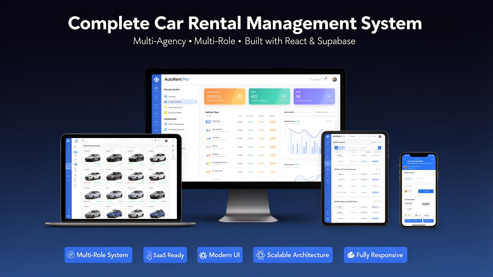
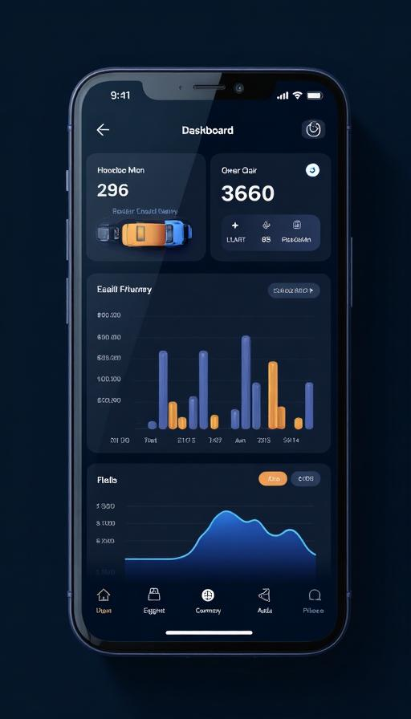

# 🚗 AutoRent Pro — Complete Car Rental Management System

<p align="center">
  
</p>

---

## ✨ Overview

**AutoRent Pro** is a complete, production-ready car rental management system built with **React 18**, **TypeScript**, and **Supabase**. Designed for car rental agencies of all sizes — from single-location startups to multi-agency enterprises.

Launch your own car rental SaaS platform in minutes with a fully featured dashboard, role-based access control, fleet management, bookings, accounting, **Stripe-powered subscriptions**, and more.

---

## 🎯 Why Choose AutoRent Pro?

### 🏆 3 Reasons to Buy

1. **Production-Ready Out of the Box** — Not a prototype. This is a complete, battle-tested system with authentication, RLS security, multi-tenancy, and real business logic. Deploy to production in under 30 minutes.

2. **True Multi-Role Architecture** — Three distinct user roles (Super Admin → Agency Admin → Employee) with granular, database-enforced permissions. Each role sees only what they should — no hacky client-side checks.

3. **SaaS-Ready with Stripe** — Built-in subscription management with 3 plans (Basic, Pro, Enterprise), self-service onboarding, and a Super Admin panel for manual subscription control. Start monetizing immediately.

### 🥊 Competitive Advantages

| AutoRent Pro | Typical Competitors |
|---|---|
| Real multi-agency with RLS isolation | Single-tenant, no data isolation |
| 3-tier role system (Super Admin/Admin/Agent) | Basic admin/user only |
| Built-in Stripe subscriptions & onboarding | No monetization tools |
| Modern React 18 + TypeScript + Tailwind | jQuery or outdated frameworks |
| Supabase backend (auto-scales) | PHP/MySQL with manual server management |
| Built-in license system for reselling | No monetization tools |
| Bilingual (EN/FR) with i18n ready | Single language |

### 🎯 Target Audience

| Audience | Use Case |
|----------|----------|
| **Car Rental Agencies** | Manage fleet, bookings, clients, and accounting in one place |
| **SaaS Founders** | White-label and resell as a subscription-based platform |
| **Startups** | Launch a car rental MVP in days instead of months |
| **Web Agencies** | Deliver turnkey solutions to clients in the rental industry |
| **Enterprise** | Multi-branch operations with centralized control |

---

## 🚀 Key Features

### 📊 Multi-Role Dashboard Architecture
- **Super Admin Dashboard** — Full overview across all agencies, user management, subscription management
- **Agency Admin Dashboard** — Agency-specific metrics, employee management, fleet oversight
- **Employee Dashboard** — Day-to-day operations: rentals, reservations, client management

### 💳 SaaS Subscription System (Stripe)
- **3 Plans**: Basic ($29/mo), Pro ($59/mo), Enterprise ($99/mo) with yearly discounts
- **Self-Service Onboarding**: New customers register, pay, and get instant access
- **Feature Gating**: Vehicle, user, and agency limits enforced per plan
- **Subscription Guard**: Expired accounts redirected to billing page
- **Super Admin Control**: Manually create, modify, extend, or cancel subscriptions
- **Stripe Customer Portal**: Users manage their own billing, payment methods, and cancellations

### 🔐 Role-Based Access Control (RBAC)
- Three-tier hierarchy: Super Admin → Agency Admin → Employee (Agent)
- Database-enforced permissions via PostgreSQL Row Level Security (RLS)
- Security definer functions prevent privilege escalation
- Each user sees only data they're authorized to access
- **Super Admin never has a subscription** — manages all agency subscriptions

### 🚗 Vehicle Fleet Management
- Complete vehicle registry with brand, model, year, registration
- Real-time status tracking: Available, Rented, Reserved, Maintenance
- Document expiry alerts: Insurance, Technical Inspection, Registration Card
- Daily rate management per vehicle
- Vehicle card view with status badges

### 📅 Booking & Reservation System
- Full reservation lifecycle: Pending → Confirmed → Converted to Rental
- Seamless reservation-to-rental conversion
- Date conflict detection
- Client and vehicle linking
- Notes and amount tracking

### 📋 Rental Contract Management
- Active rental monitoring with overdue detection
- Payment tracking (total amount, amount paid, balance)
- Actual return date recording
- Linked to reservations for full audit trail

### 👥 Client Management
- Comprehensive client database with contact details
- ID and license number tracking
- **Blacklist system** with reason tracking
- Per-agency client isolation
- Search and filter capabilities

### 💰 Accounting & Financial Reports
- Income and expense tracking
- Category-based transaction classification
- Monthly revenue and expense summaries
- Revenue vs. expenses visualization with charts
- Net balance calculation
- Linked to rental contracts for automatic income recording

### 🏢 Multi-Agency Management
- Unlimited agencies with centralized control
- Per-agency data isolation via RLS
- Agency selector for admins managing multiple locations
- Agency-specific employees, vehicles, clients, and transactions

### 👨‍💼 Employee & User Management
- Employee registry with position, hire date, contact info
- Create user accounts for employees directly from the employee form
- Activate/deactivate employee accounts
- Admin-to-agency assignment for multi-agency admins

### 👨‍✈️ Driver Management
- Driver database with license tracking
- License expiry monitoring
- Active/inactive status management

### ⚙️ System Settings & Configuration
- Dark/Light theme toggle
- Bilingual interface (English / French)
- License-based activation system
- Configurable from environment variables

### 📱 Fully Responsive Design
- Desktop-first with full mobile and tablet support
- Collapsible sidebar with mobile drawer
- Touch-optimized interactions
- Responsive data tables and cards

---

## 🛠️ Tech Stack

| Technology | Usage |
|------------|-------|
| **React 18** | Frontend framework with hooks & functional components |
| **TypeScript** | Full static typing across the entire codebase |
| **Tailwind CSS** | Utility-first styling with custom design system |
| **shadcn/ui** | Premium UI components (40+ components) |
| **Supabase** | Backend: PostgreSQL, Auth, Edge Functions, RLS |
| **Stripe** | Subscription billing, checkout, customer portal |
| **TanStack Query v5** | Server state management & caching |
| **React Router v6** | Client-side routing with protected routes |
| **Recharts** | Data visualization & charts |
| **React Hook Form + Zod** | Form management with schema validation |
| **i18next** | Internationalization (EN/FR) |
| **Vite** | Lightning-fast build tool & dev server |
| **Lucide React** | Beautiful icon library |
| **date-fns** | Date manipulation & formatting |
| **Sonner** | Toast notifications |

---

## 📁 Package Structure

```
AutoRent-Pro/
├── 📁 app/                      # Full source code
│   ├── src/
│   │   ├── components/          # Reusable UI components
│   │   │   ├── ui/              # shadcn/ui base components (40+)
│   │   │   ├── layout/          # App layout (Sidebar, Header, etc.)
│   │   │   ├── dashboard/       # Dashboard widgets
│   │   │   ├── vehicles/        # Vehicle management components
│   │   │   ├── clients/         # Client management components
│   │   │   ├── rentals/         # Rental components
│   │   │   ├── reservations/    # Reservation components
│   │   │   ├── accounting/      # Financial components
│   │   │   ├── employees/       # Employee components
│   │   │   ├── drivers/         # Driver components
│   │   │   ├── agencies/        # Agency components
│   │   │   ├── users/           # User management components
│   │   │   ├── billing/         # Subscription management (AdminBillingPanel)
│   │   │   └── landing/         # Landing page components
│   │   ├── pages/               # Route pages (17+ pages)
│   │   ├── hooks/               # Custom React hooks (14+ hooks)
│   │   ├── contexts/            # React contexts (Auth, Agency, License, Subscription)
│   │   ├── config/              # Plan definitions (subscriptionPlans.ts)
│   │   ├── i18n/                # Internationalization (EN/FR)
│   │   ├── integrations/        # Supabase client & types
│   │   └── lib/                 # Utility functions
│   ├── supabase/
│   │   └── functions/           # Edge Functions
│   │       ├── create-user/     # User provisioning + subscription creation
│   │       ├── manage-user/     # User management
│   │       ├── seed-admin/      # Initial admin setup
│   │       ├── verify-license/  # License validation
│   │       ├── create-checkout/ # Stripe checkout sessions
│   │       ├── check-subscription/ # Subscription verification
│   │       ├── customer-portal/ # Stripe billing portal
│   │       ├── onboard-checkout/ # Self-service onboarding checkout
│   │       └── stripe-webhook/  # Stripe event handling
│   ├── public/                  # Static assets
│   └── package.json
├── 📁 docs/                     # Complete documentation
│   ├── INSTALLATION.md          # Step-by-step setup guide
│   ├── CONFIGURATION.md         # Customization guide
│   ├── ACTIVATION.md            # License activation
│   ├── DEPLOYMENT.md            # Production deployment
│   └── FAQ.md                   # Frequently asked questions
├── 📁 database/
│   └── schema.sql               # Complete database schema
├── 📁 assets/                   # Marketing screenshots
├── 📄 README.md                 # This file
├── 📄 LICENSE.txt               # Commercial license
├── 📄 CHANGELOG.md              # Version history
└── 📄 SUPPORT.txt               # Support contact
```

---

## ⚡ Quick Start

```bash
cd app/
npm install
cp .env.example .env
# Configure your Supabase keys in .env
npm run dev
```

📖 Full guide: [`docs/INSTALLATION.md`](docs/INSTALLATION.md)

---

## 📸 Screenshots

### Dashboard
| Super Admin Dashboard | Agency Admin Dashboard |
|---|---|
|  |  |

### Core Modules
| Vehicle Fleet | Accounting |
|---|---|
|  |  |

### Responsive Design
| Mobile View |
|---|
|  |

---

## 🔐 Security Features

- **Row Level Security (RLS)** on all 15 tables
- **Security Definer Functions** for role checks (no recursive RLS)
- **Database-enforced permissions** — not just UI-level checks
- **JWT-based authentication** via Supabase Auth
- **No sensitive credentials** in client-side code
- **Edge Functions** with service role for privileged operations
- **License system** for domain-based activation
- **Stripe webhook signature verification** for payment security
- **Subscription Guard** preventing unauthorized feature access

---

## 🌍 Internationalization

AutoRent Pro ships with full **English** and **French** translations. Adding new languages is straightforward:

1. Create a new locale file in `src/i18n/locales/`
2. Register it in `src/i18n/index.ts`
3. All UI strings are translation-ready

---

## 📋 Browser Compatibility

| Browser | Version |
|---------|---------|
| Chrome | 90+ |
| Firefox | 88+ |
| Safari | 14+ |
| Edge | 90+ |
| Mobile Chrome | Latest |
| Mobile Safari | Latest |

---

## 📄 License

This product is distributed under a **commercial license**. See [`LICENSE.txt`](LICENSE.txt) for details.

**One license = one domain.**

---

## 💬 Support

📧 See [`SUPPORT.txt`](SUPPORT.txt) to contact us.

---

## 📝 Changelog

See [`CHANGELOG.md`](CHANGELOG.md) for version history.

---

<p align="center">
  <strong>AutoRent Pro</strong> — The Complete Car Rental Management System<br/>
  Built with ❤️ for car rental agencies worldwide
</p>
